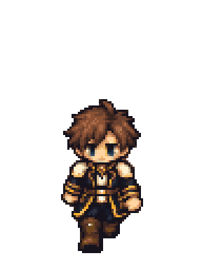
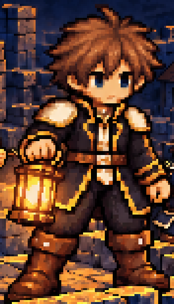
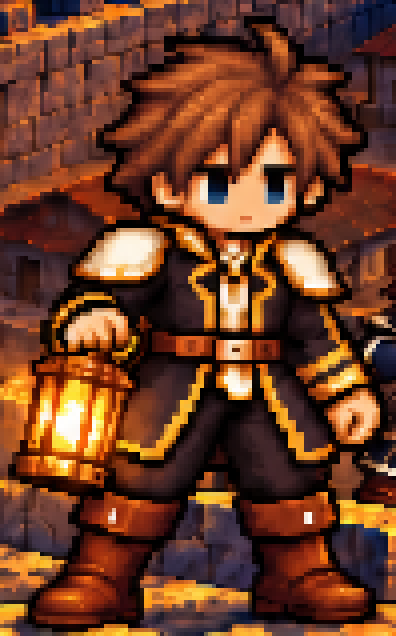
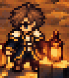

# K-131 · 스토어 그림 주인공 수정

[수정 전후 검토 페이지](../../../_HTML/6_그림_화면/codex_K-131_스토어그림_주인공수정_v1.html)는 그림을 내장하므로 서버 없이 열 수 있습니다. 세 그림의 수정 전후, 현재 게임 기준, 주인공 확대, 하단 1/3 가림, 제출 원본 열기를 제공합니다.

루멘의 은발을 현재 게임의 갈색 머리로 바꾸고 넓은 흰색 어깨 칼라, 어두운 생도복, 금색 테두리, 등불지기 망토와 작은 등불을 맞췄습니다. 머리 모양은 현재 게임의 짧고 흐트러진 옆가르마를 따릅니다. K-070과 초기 v6의 은발은 이번 머리색 기준으로 사용하지 않았습니다. 큰 머리·짧고 튼튼한 몸·갈색 장화의 방향은 유지합니다.

| 현재 게임 정면 시트에서 추출 | 수정된 포스터 주인공 | 수정된 표지 주인공 | 수정된 가로 전경 주인공 |
|---|---|---|---|
|  |  |  |  |

뒷모습은 `Game/Assets/_Project/Art/Characters/Hero/hero_back_idle.png`, 정면과 옆모습은 `hero_walk_run_grid.png`를 읽었습니다. 통합 자료 `codex_character_integration_v1`과 `C:/Unity/1/HLR-builds/w45_smoke/smoke_02_battle.png`도 확인했습니다. 전투 캡처의 중앙 갈색 머리·흰색 칼라 인물을 기준으로 삼았습니다. 게임 시트를 변경하지 않았습니다.

궁수는 현재 시트의 갈색 머리·남색 제복·흰 테두리·갈색 장화·목제 활과 비교했습니다. 기존 병사 방향이 맞으므로 별도 재설계하지 않았으며, 주인공 수정 사각형 밖의 모든 병사는 원본 픽셀을 보존했습니다.

## 제출 파일

| 파일 | 크기 |
|---|---|
| `store/poster_1440x2160.png` | 1440×2160 |
| `store/poster_720x1080.png` | 720×1080 |
| `store/box_2160x2160.png` | 2160×2160 |
| `store/box_1080x1080.png` | 1080×1080 |
| `store/super_hero_3840x2160.png` | 3840×2160 |
| `store/super_hero_1920x1080.png` | 1920×1080 |
| `store/app_tile_300x300.png` | 300×300・K-130에서 변경 없이 복사 |

`store/`의 파일명과 크기는 K-130과 같습니다. `previews/*_native.png`는 논리 원본이며 `*_4x.png`는 최근접 4배입니다. 작은 제출 파일은 논리 원본의 최근접 2배입니다. 프레임·움직임·96×128 칸·발 피벗은 정지 스토어 그림에 해당하지 않습니다.

## 보존 범위와 제작

내장 image_gen 도구로 인물을 수정하고, 생성본의 제한된 인물 주변 사각형만 기존 논리 원본에 합성했습니다. 사각형 안의 가까운 바닥·배경도 일부 포함됩니다. 수정 사각형 밖은 원본 픽셀 그대로입니다. 제목 **빛을 잇는 자들 / LIGHTBEARERS**, 봉화·광선·요새·적 무리와 하단 1/3을 보존했습니다. 가로 전경에는 글자가 없습니다. 새 핵심 요소를 하단에 추가하지 않았습니다.

`prompts.json`에 실제 요청문을 기록했습니다. 정사각 표지는 한쪽에 남은 금색 견장을 흰색으로 추가 수정했습니다. 가로 전체 생성본은 위치가 달라 채택하지 않았으며, 원본 인물 주변 확대본을 다시 수정해 사용했습니다. 크기 변환과 합성에는 System.Drawing의 최근접 보간을 사용했습니다.

제작 전 [픽셀 확대 원칙](https://developer.mozilla.org/en-US/docs/Games/Techniques/Crisp_pixel_art_look)과 [생성형 픽셀 그림의 불규칙한 픽셀·흐림 문제](https://www.sprite-lab.com/guides/how-to-make-pixel-art-sprites-for-games)를 읽고 카드 결과 첫머리에 구체적인 금지 항목을 작성했습니다.

## 확인 결과

- 제출 여섯 파일의 크기, 전체 픽셀 불투명도, 정확한 최근접 4배·2배 확대를 검사했습니다. 불일치 0입니다.
- 세 논리 원본의 수정 사각형 밖 변경 0, 하단 1/3 변경 0입니다. 앱 타일은 원본과 SHA-256이 같습니다.
- 최종 인물 확대에서 갈색 머리·흰 칼라·발 접촉·수정 경계를 육안 확인했습니다. 불투명 홍보 그림이므로 투명 여백의 떠 있는 픽셀 검사는 해당하지 않습니다.
- 검토 HTML의 이미지 13개를 실제로 디코딩해 크기가 유효함을 확인했습니다. 외부 이미지 의존성이 없습니다.
- 연결된 사용 가능 브라우저가 없어 브라우저 렌더링·가림 버튼 동작 검사는 수행하지 못했습니다. 이를 완료로 기록하지 않았습니다.

검사 수치와 파일 해시는 `verification.json`, 크기·수정 영역은 `manifest.json`에 있습니다. Unity 실행·게임 연결·스토어 등록·Git 쓰기는 하지 않았습니다. 클로드가 검토 페이지를 브라우저에서 열고 스토어 등록 화면의 최종 표시를 확인한 뒤 커밋해야 합니다.
